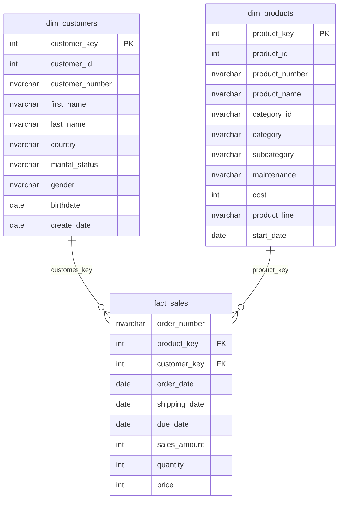

# Catálogo de datos - Capa Gold

Documentación de las vistas finales en el esquema `gold`, organizadas en un modelo en estrella (Star Schema) para consultas y reportes de ventas.

## Modelo en estrella

## 1. `gold.dim_customers`
Contiene la información consolidada de clientes uniendo `silver.crm_cust_info`, `silver.erp_cust_az12` y `silver.erp_loc_a101`.

| Columna | Tipo | Descripción |
| :--- | :--- | :--- |
| `customer_key` | INT | Clave subrogada generada para la dimensión. |
| `customer_id` | INT | Identificador numérico original del cliente en CRM. |
| `customer_number` | NVARCHAR(50) | Código alfanumérico del cliente (`cst_key`). |
| `first_name` | NVARCHAR(50) | Nombre del cliente. |
| `last_name` | NVARCHAR(50) | Apellido del cliente. |
| `country` | NVARCHAR(50) | País de residencia del cliente. |
| `marital_status` | NVARCHAR(50) | Estado civil (`Married`, `Single`, `n/a`). |
| `gender` | NVARCHAR(50) | Género (`Male`, `Female`, `n/a`). |
| `birthdate` | DATE | Fecha de nacimiento. |
| `create_date` | DATE | Fecha de registro del cliente. |

## 2. `gold.dim_products`
Contiene el catálogo de productos vigentes (`prd_end_dt IS NULL`) uniendo `silver.crm_prd_info` y `silver.erp_px_cat_g1v2`.

| Columna | Tipo | Descripción |
| :--- | :--- | :--- |
| `product_key` | INT | Clave subrogada generada para la dimensión. |
| `product_id` | INT | Identificador original del producto. |
| `product_number` | NVARCHAR(50) | Código del producto para cruce con ventas. |
| `product_name` | NVARCHAR(50) | Nombre descriptivo del producto. |
| `category_id` | NVARCHAR(50) | Código de categoría extraído de la clave del producto. |
| `category` | NVARCHAR(50) | Categoría principal (ej. `Bikes`, `Components`). |
| `subcategory` | NVARCHAR(50) | Subcategoría del producto. |
| `maintenance` | NVARCHAR(50) | Indica si requiere mantenimiento (`Yes` / `No`). |
| `cost` | INT | Costo unitario del producto. |
| `product_line` | NVARCHAR(50) | Línea del producto (`Mountain`, `Road`, `Touring`, etc.). |
| `start_date` | DATE | Fecha de inicio de vigencia del producto. |

## 3. `gold.fact_sales`
Contiene las transacciones de ventas vinculadas a las dimensiones de clientes y productos mediante sus claves subrogadas.

| Columna | Tipo | Descripción |
| :--- | :--- | :--- |
| `order_number` | NVARCHAR(50) | Número de orden de venta (`SO...`). |
| `product_key` | INT | Clave foránea hacia `gold.dim_products`. |
| `customer_key` | INT | Clave foránea hacia `gold.dim_customers`. |
| `order_date` | DATE | Fecha en que se realizó el pedido. |
| `shipping_date` | DATE | Fecha de envío del pedido. |
| `due_date` | DATE | Fecha límite de entrega/pago. |
| `sales_amount` | INT | Monto total de la línea de venta (`quantity * price`). |
| `quantity` | INT | Cantidad de unidades vendidas. |
| `price` | INT | Precio unitario de venta. |
