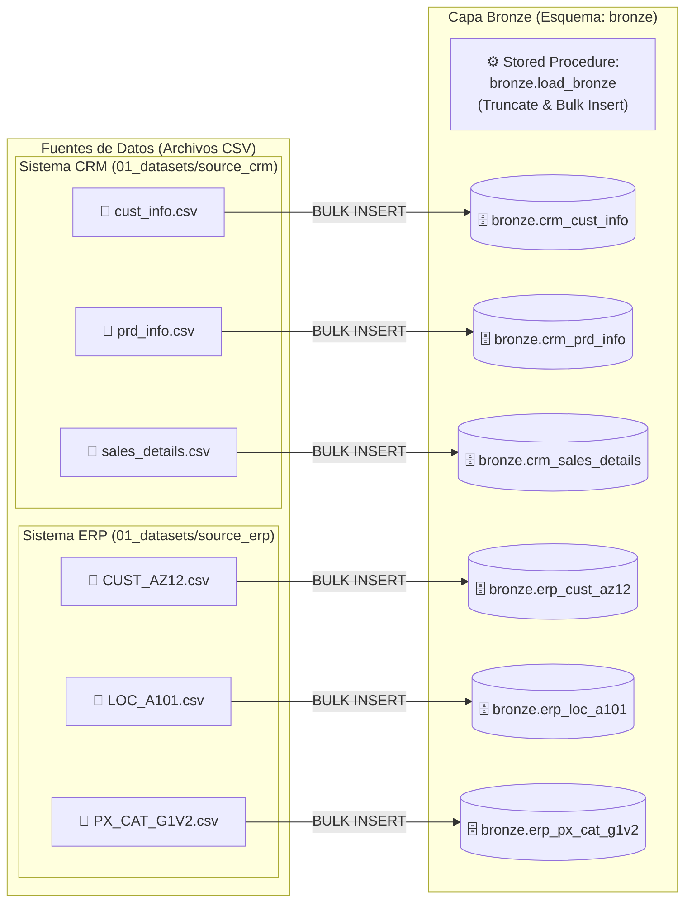
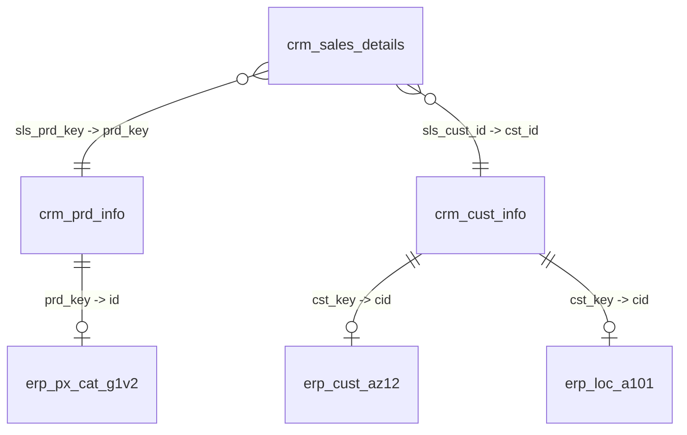

# Flujo de Datos y Documentación - Capa Bronze

Este documento describe el flujo de ingesta de datos desde los sistemas de origen (**CRM** y **ERP**) hacia la **Capa Bronze** del almacén de datos (`DataWarehouse`) en SQL Server.

---

## 1. Diagrama de Flujo de Datos (Capa Bronze)

---

## 2. Detalle de Tablas e Ingesta en Capa Bronze

| Sistema Origen | Archivo CSV | Tabla Destino (Bronze) | Método de Carga | Transformaciones |
| :--- | :--- | :--- | :--- | :--- |
| **CRM** | `cust_info.csv` | `bronze.crm_cust_info` | `TRUNCATE` + `BULK INSERT` | Ninguna (Datos en bruto) |
| **CRM** | `prd_info.csv` | `bronze.crm_prd_info` | `TRUNCATE` + `BULK INSERT` | Ninguna (Datos en bruto) |
| **CRM** | `sales_details.csv` | `bronze.crm_sales_details` | `TRUNCATE` + `BULK INSERT` | Ninguna (Datos en bruto) |
| **ERP** | `CUST_AZ12.csv` | `bronze.erp_cust_az12` | `TRUNCATE` + `BULK INSERT` | Ninguna (Datos en bruto) |
| **ERP** | `LOC_A101.csv` | `bronze.erp_loc_a101` | `TRUNCATE` + `BULK INSERT` | Ninguna (Datos en bruto) |
| **ERP** | `PX_CAT_G1V2.csv` | `bronze.erp_px_cat_g1v2` | `TRUNCATE` + `BULK INSERT` | Ninguna (Datos en bruto) |

---

## 3. Relaciones entre Entidades de Origen

