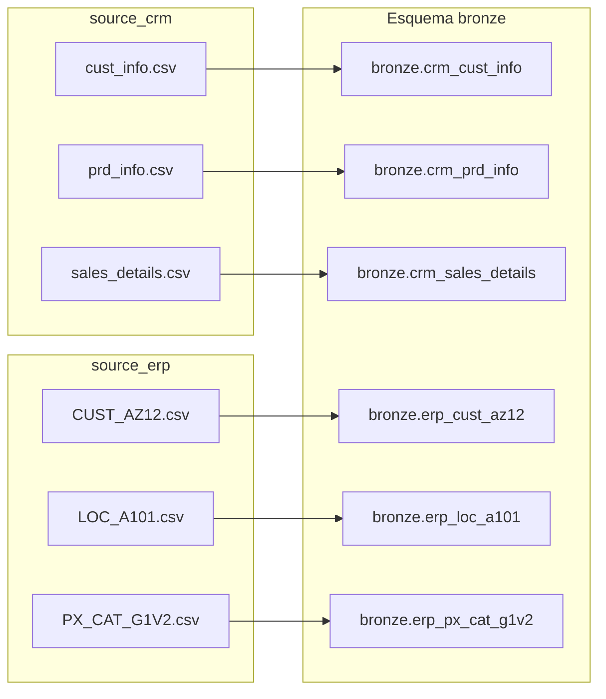

# Flujo de datos - Capa Bronze

En la capa Bronze se cargan los 6 archivos CSV de los sistemas CRM y ERP directamente en tablas de SQL Server sin hacerles cambios, usando `TRUNCATE TABLE` y `BULK INSERT` dentro del procedimiento `bronze.load_bronze`.

## Diagrama de flujo

## Tablas de origen y destino

| Origen | Archivo CSV | Tabla en Bronze |
| :--- | :--- | :--- |
| CRM | `cust_info.csv` | `bronze.crm_cust_info` |
| CRM | `prd_info.csv` | `bronze.crm_prd_info` |
| CRM | `sales_details.csv` | `bronze.crm_sales_details` |
| ERP | `CUST_AZ12.csv` | `bronze.erp_cust_az12` |
| ERP | `LOC_A101.csv` | `bronze.erp_loc_a101` |
| ERP | `PX_CAT_G1V2.csv` | `bronze.erp_px_cat_g1v2` |
